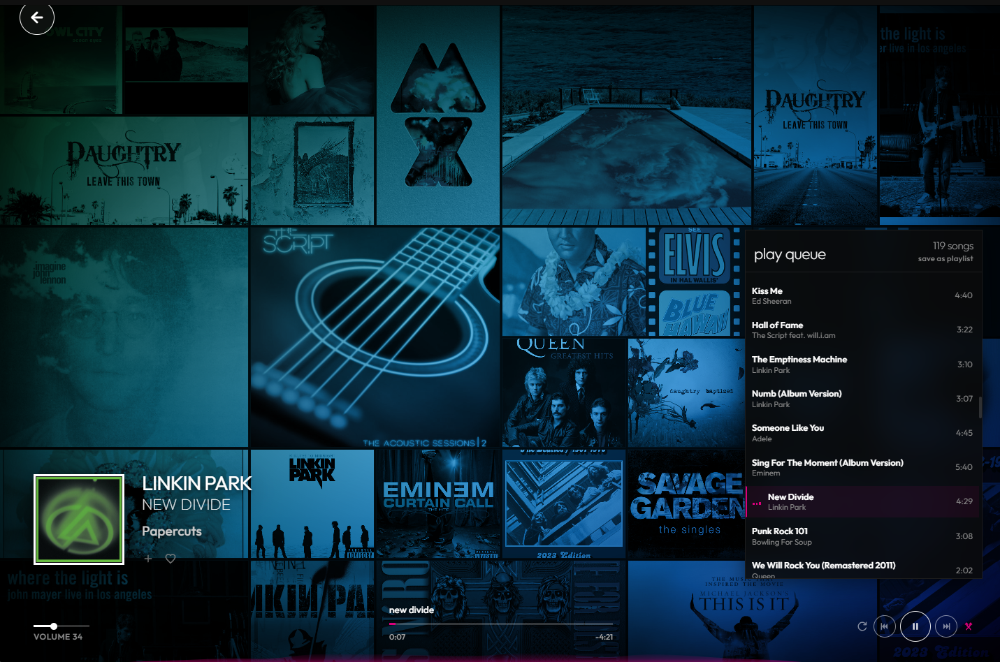
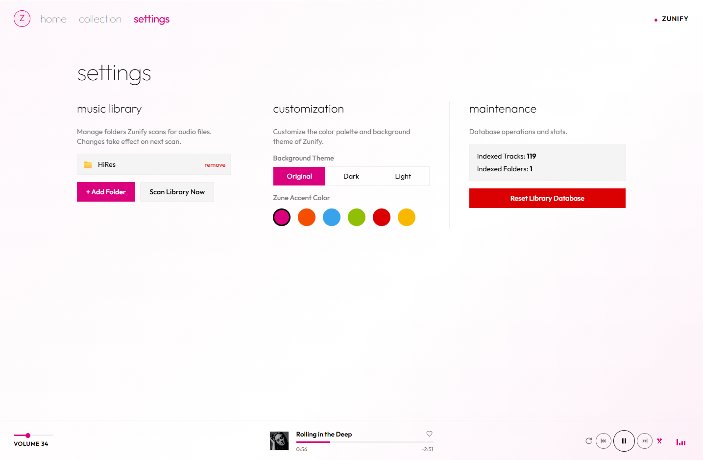

<p align="center">
  
</p>

<h1 align="center">Zunify</h1>
<p align="center"><strong>A Beautiful, Lightweight, Offline-First Zune-Inspired Music Player</strong></p>

<p align="center">
  <strong>Bring back the nostalgia of the late-2000s Zune Metro UI to your web browser.</strong><br>
  Synchronize your local music collection directly via the File System Access API—zero server uploads, zero accounts, zero trackers, and 100% offline-ready.
</p>

<p align="center">
  <a href="#zunify"></a>
  <a href="#zunify"></a>
  <a href="#zunify"></a>
  <a href="#zunify"></a>
  <a href="#zunify"></a>
</p>

<p align="center">
  <a href="https://zunify.breejeshrathod.com/" target="_blank">
    
  </a>
</p>

---

### Why Zunify?

Most modern music players require bloated accounts, premium monthly subscriptions, tracking telemetry, or constant internet connectivity.

**Zunify is the antidote.** Inspired by the iconic design language of the original Microsoft Zune, it is built on three core pillars:

- **100% Offline-First & Private:** Zunify uses the browser's native **File System Access API** and **IndexedDB** (via Dexie.js). You authorize a local music directory, and Zunify scans, extracts tags, and plays files directly from your disk on-device. No files are ever uploaded, and no listening data ever leaves your browser.
- **Iconic Zune Aesthetics:** A faithful reimagining of the Zune "Metro" interface. Minimalist layouts, typography-first hierarchy, high-contrast menus, and dynamic background artwork.
- **Zero Logins, Zero Telemetry:** There are no sign-up forms, no email collection, and no backend tracking servers. Just open the app and listen to your music.
- **Progressive Web App (PWA):** Install it as a standalone app on your desktop, macOS, or Android/iOS device. Play your local music even without internet access.

---

### Gallery & Showcase

Here is a look at Zunify in action, highlighting its beautiful styling:

#### 1. Home / Quickplay Hub
The starting screen provides rapid access to your playback history, most-played tracks, and favorited songs.
<p align="center">
  
</p>

#### 2. The Music Collection
Browse all imported tracks grouped by artists, albums, or search terms, and construct custom playlists.
<p align="center">
  
</p>

#### 3. Now Playing (Immersive Mode)
Immerse yourself in a full-screen, typography-first visualization of your active track. The layout scales beautifully, featuring dynamic ambient backdrops that shift and morph to match the colors of the current album art.
<p align="center">
  
  <br><br>
  
</p>

#### 4. Settings & Customization
Tailor the player to your style. Switch themes between Dark, Light, and Original hybrid styling, and customize the accent color.
<p align="center">
  
</p>

---

### Key Features

- **Directory Syncing:** Grant access to local music folders using the standard File System Access API. Zunify handles directory traversal and incremental scanning.
- **Local Metadata Extraction:** Parses MP3, M4A, FLAC, and WAV audio metadata (album art, artist names, track info, year, duration) locally using `music-metadata-browser`.
- **Zune's Heart Rating System:** Quickly favorite or un-favorite songs with the classic Zune heart icon to customize your Quickplay hub.
- **Visual Customization:**
  - **Themes:** Choose from **Original** (Zune's iconic hybrid dark/light layout), **Pure Dark**, or **Pure Light**.
  - **Accent Colors:** Six custom accent presets including **Magenta** (Zune's signature pink), **Orange**, **Cyan**, **Green**, **Red**, and **Yellow**.
  - **Dynamic Elements:** The tab favicons and system theme bar colors change dynamically depending on your active accent color and theme selection.
- **Playlists & History:** Create custom playlists locally. The app retains a rolling playback history of your last 50 songs.
- **PWA Support:** Serves static files and controls assets using Service Workers, allowing immediate local loads and offline operations.

---

### Technical Architecture

Zunify is built purely on modern web technologies:
- **Framework:** [Angular 19](https://angular.dev/) with Signals for reactive, efficient state updates.
- **Database:** [Dexie.js](https://dexie.org/) as a robust IndexedDB wrapper to store scanned metadata, local playlist mappings, and cached album art Blobs.
- **Audio Core:** Web Audio API & native Audio Elements for seamless local file playback.
- **Styling:** CSS variables mapped dynamically to theme settings for instant accent/theme transitions.

---

### Developer Setup

To run Zunify locally or host it on your own server, follow these instructions.

#### Prerequisites
- Node.js (v18.19+ recommended)
- Angular CLI (`npm i -g @angular/cli`)

#### Running Locally
1. Clone the repository and navigate to the project directory:
   ```bash
   cd zunify
   ```
2. Install the dependencies:
   ```bash
   npm install
   ```
3. Start the Angular development server:
   ```bash
   npm start
   ```
4. Open your browser and navigate to `http://localhost:4200/`.

#### Building for Production
To compile and build optimized static assets for hosting or deployment:
```bash
npm run build
```
The output directory will be created at `dist/zunify`. You can host these files on any static hosting provider (e.g., GitHub Pages, Vercel, Netlify, Cloudflare Pages).

---

### License

This project is open-source and available under the [MIT License](LICENSE).
