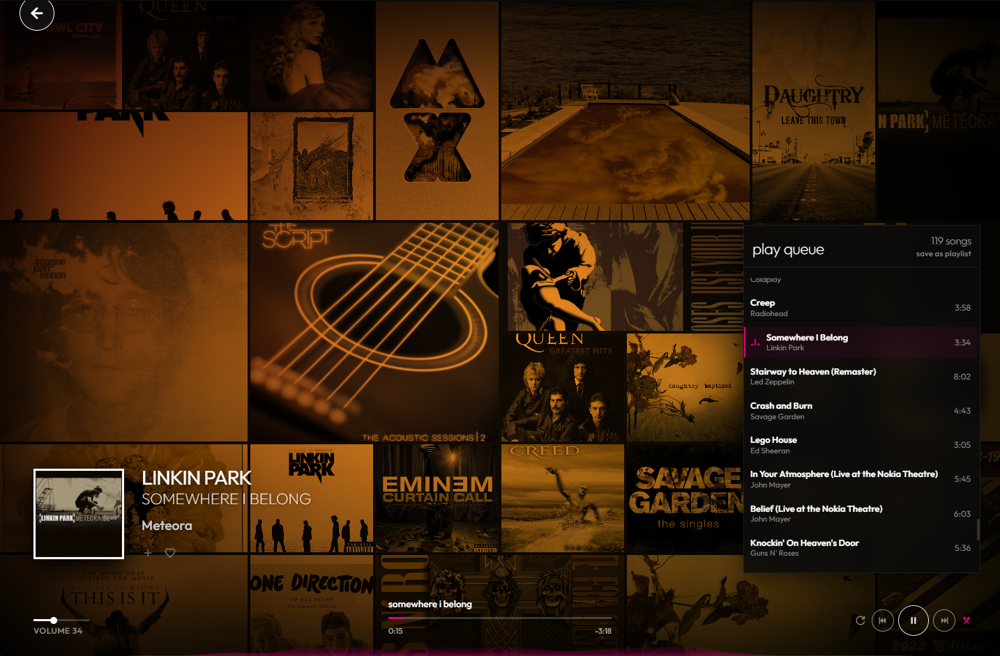
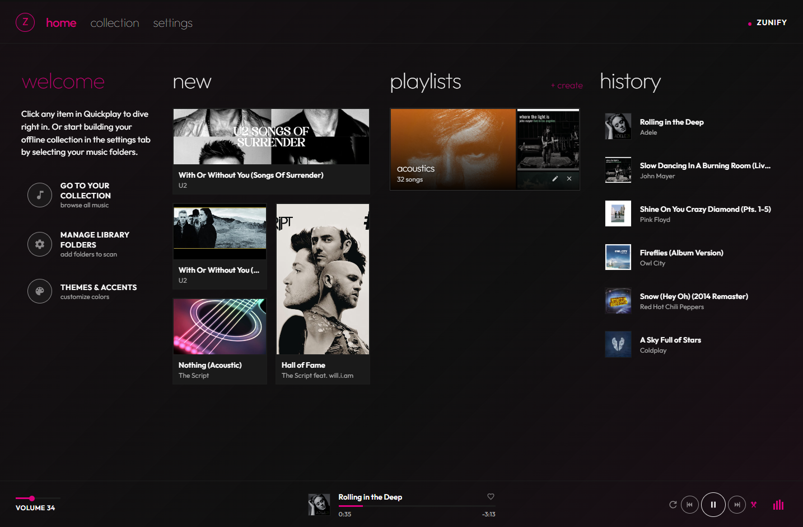
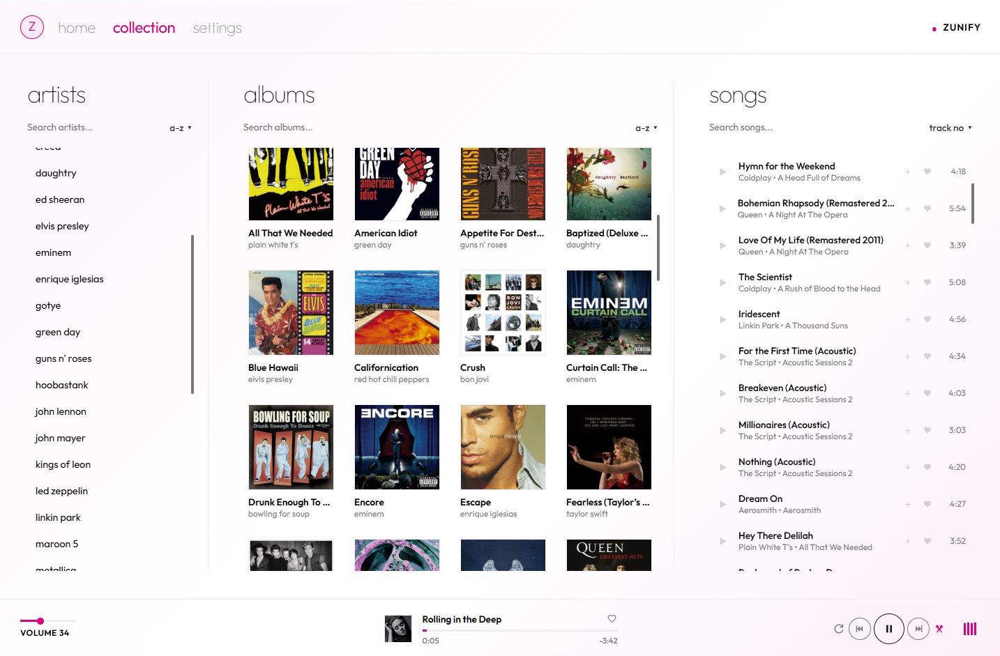

<p align="center">
  
</p>

<h1 align="center">Zunify</h1>
<p align="center"><strong>The Zune music player, reborn for your desktop.</strong></p>

<p align="center">
  A free, offline-first music player for <b>Windows, macOS and Linux</b> that recreates the iconic Zune Metro interface.<br>
  It plays the music already on your computer. No accounts, no streaming, no tracking.
</p>

<p align="center">
  <a href="https://github.com/breejesh/zunify/releases/latest"></a>
  <a href="https://github.com/breejesh/zunify/actions/workflows/build-desktop.yml"></a>
  <a href="#zunify"></a>
  <a href="LICENSE"></a>
</p>

<p align="center">
  <a href="https://zunify-84327.web.app"><b>Website</b></a> ·
  <a href="https://zunify-84327.web.app/#demo"><b>Live browser demo</b></a> ·
  <a href="https://github.com/breejesh/zunify/releases/latest"><b>Download</b></a>
</p>

<p align="center">
  
</p>

---

## ⬇️ Download

Grab the latest build from the [**Releases page**](https://github.com/breejesh/zunify/releases/latest):

| Platform | File |
| --- | --- |
| Windows 10/11 (installer) | [`Zunify-Setup-x64.exe`](https://github.com/breejesh/zunify/releases/latest/download/Zunify-Setup-x64.exe) |
| Windows (portable, no install) | [`Zunify-Portable-x64.exe`](https://github.com/breejesh/zunify/releases/latest/download/Zunify-Portable-x64.exe) |
| macOS, Apple Silicon | [`Zunify-mac-arm64.dmg`](https://github.com/breejesh/zunify/releases/latest/download/Zunify-mac-arm64.dmg) |
| macOS, Intel | [`Zunify-mac-x64.dmg`](https://github.com/breejesh/zunify/releases/latest/download/Zunify-mac-x64.dmg) |
| Linux (any distro) | [`Zunify-linux-x86_64.AppImage`](https://github.com/breejesh/zunify/releases/latest/download/Zunify-linux-x86_64.AppImage) |
| Debian / Ubuntu | [`Zunify-linux-amd64.deb`](https://github.com/breejesh/zunify/releases/latest/download/Zunify-linux-amd64.deb) |

> **First launch.** Builds are not code-signed yet.
> **Windows:** on a SmartScreen prompt, click *More info → Run anyway*.
> **macOS:** if the app is reported as damaged or from an unidentified developer, run `xattr -cr /Applications/Zunify.app` once.
> **Linux:** `chmod +x` the AppImage before running it (Ubuntu 22.04+ also needs `libfuse2`).

---

## 🎧 Features

- **Now Playing, Zune style:** a full-screen, animated mosaic of your own album art, big type and a live visualizer.
- **Metro collection:** browse artists, albums and songs in classic pivot columns, with sorting and search.
- **Private by design:** no account, no cloud, no telemetry. The library lives in a local database on your machine.
- **Lossless ready:** FLAC, WAV, MP3, M4A, AAC and OGG, with tags and embedded cover art read straight from your files.
- **Hearts & playlists:** favourite tracks, build and drag-reorder playlists, save the play queue in one click.
- **Truly native:** frameless window with custom controls (native traffic lights on macOS), hardware media keys,
  OS media controls, and playback that keeps going while minimized or behind other windows.
- **Make it yours:** Original, Dark and Light themes plus six classic Zune accent colours.

<p align="center">
  
  
</p>

---

## 📁 Repository structure

```text
zunify/
├── player/                 # The desktop app (Electron + Angular 19)
│   ├── electron/           # Main process & preload bridge (window controls, media keys, dialogs)
│   ├── src/                # Angular UI: quickplay, collection, now playing, settings
│   ├── public/             # Static assets (icons, demo library used only by the web demo)
│   ├── build/              # Installer icons for electron-builder
│   └── package.json        # App scripts + electron-builder config
│
├── website/                # Product website (static, Firebase Hosting)
│   ├── index.html · styles.css · app.js
│   ├── demo/               # Web build of the player, embedded as the live demo (generated)
│   └── doc-images/         # Screenshots & logo
│
├── scripts/
│   ├── build-demo.js       # Builds the player and copies it into website/demo
│   └── generate-icons.js   # Regenerates app icons from doc-images/logo.svg
│
└── .github/workflows/
    └── build-desktop.yml   # Builds Windows/macOS/Linux and publishes GitHub Releases
```

---

## 🛠️ Development

Requires **Node.js 22** (see `.nvmrc`); electron-builder 26 and Angular 19 need Node ≥ 20.19.

```bash
cd player
npm install

npm run electron:dev   # Angular dev server + Electron window with live reload
npm run build          # Production renderer build into player/dist
npm run electron       # Run Electron against the production build
```

### Packaging locally

```bash
cd player
npm run dist           # Installer(s) for the current OS
npm run dist:win       # Windows NSIS installer + portable exe
npm run dist:mac       # macOS dmg (arm64 + x64)
npm run dist:linux     # Linux AppImage + .deb
```

Output lands in `player/dist-desktop/`. The same scripts are available from the repo root
(`npm run dist:desktop`, `npm run dist:win`, ...).

### Releasing

Every push and pull request that touches the app builds all three platforms in GitHub Actions,
so packaging problems surface early. To publish a release:

```bash
git tag v1.0.1
git push origin v1.0.1
```

The workflow stamps the tag's version into the app, builds Windows, macOS and Linux in parallel,
and publishes a GitHub Release with all installers attached. The website and the README link to
`releases/latest/download/...`, so they pick up new releases automatically.

---

## 🌐 Website

```bash
npm run dev:website      # Preview at http://localhost:3000
npm run build:demo       # Rebuild the embedded live demo from player/
npm run deploy:website   # Rebuild the demo, then deploy to Firebase Hosting
```

The website *is* a player: press play on the hero disc and a royalty-free soundtrack from the
demo library drives everything through the Web Audio API (radial spectrum, beat-flipping album
mosaic, drifting Zune typography, live tiles and a footer wordmark that dances). It also includes a
Zune HD-style horizontal panorama tour and the embedded live demo. Downloads detect the visitor's
OS and read the latest release from the GitHub API for the current version and file sizes.
Space / ← / → and the OS media keys control the site soundtrack.

---

## 📄 License

[MIT](LICENSE). Zunify is a fan tribute and is not affiliated with Microsoft.
